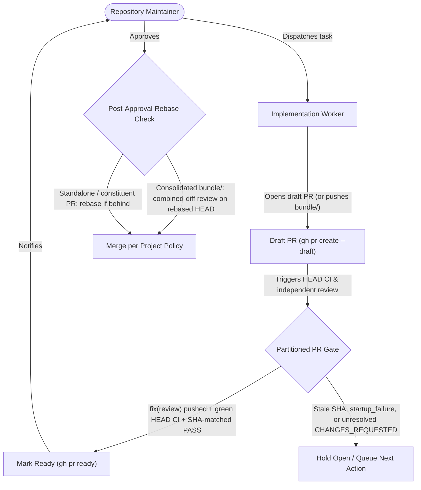

# PR Lifecycle Workflows: Partitioned Gates, Sweep Triage, and Move-Along

Specifies the pull request lifecycle across universal sweep triage (`wf-pr-sweep`), individual PR progression (`wf-pr-move-along`), and `academicOps` repository merge policies (`.agents/rules/bundled-prs.md`), decoupling discovery from execution and gating readiness on head-SHA-matched reviews and clean CI.

## User experience flow

## User stories

### US-1 Sweep operates via parallel fan-out, Class D detection, and task queuing

As a framework maintainer, I want the sweep workflow to fan out in parallel across open pull requests and recent updates (`since: <cursor>`), evaluate partitioned PR gates, surface deduplicated Class D learning triggers on agent-reviewed PRs, and queue discrete next-step tasks without executing resolutions inline, so that discovery stays decoupled from execution and fast-merged review misses never escape learning.

- **AC-1.1** Given open pull requests and pull requests updated or merged `since: <cursor>`, when `wf-pr-sweep` inspects them in parallel (projecting `reviews` (`id`, `author.login`, `state`, `submittedAt`, `body`) and comments), then open PRs needing action are queued (or mapped to existing queued tasks) for their single next step without executing fixes inline, pre-approval PRs are never queued for conflict rebase, and automated `release-please` PRs remain excluded.
- **AC-1.2** Given any open or recently merged PR (`since: <cursor>`) that carried an agent review and received a maintainer `CHANGES_REQUESTED` review or rule-miss comment, when `wf-pr-sweep` evaluates Class D triggers, then it deduplicates `(repo, pr, review_id)` against existing PKB `/learn` tasks and open `/learn` issues and emits structured `/learn` `/q` proposals without running `/learn` inline.
- **AC-1.3** Given completion of all PR evaluations in a sweep run, when the sweep finishes, then it files a closed summary task recording every evaluated PR disposition and every deduplicated Class D `/learn` `/q` proposal.

### US-2 Partitioned PR readiness gates, policy isolation, and Class D handback

As a repository maintainer, I want individual PR progression (`wf-pr-move-along`) to enforce head-SHA-matched posted reviews, non-silent CI validation, and repository-local merge policies (such as `academicOps` feature freeze, hotfix rules, and `bundle/<slug>` consolidation), so that stale approvals, errored checks, and bypassed project routes never reach merge.

- **AC-2.1** Given a constituent or standalone draft PR (`gh pr create --draft`), when `gh pr ready` is evaluated, then readiness passes only with green `HEAD` CI (0 errored, bypassed, cancelled, or `startup_failure` runs), 0 open `CHANGES_REQUESTED` reviews, 0 uncommitted reviewer `fix(review):` edits, 0 deferred DRY/SSoT/compliance findings, consistent label-vs-confirmed-route routing, and head-SHA-matched posted `## RBG Review: PASS` plus proportionate dialectical review verdicts.
- **AC-2.2** Given a consolidated `bundle/<slug>` PR governed by project bundle rules, when pre-approval readiness is checked, then every constituent holds prior multi-lens diff receipts and the bundle PR holds green `HEAD` CI plus a head-SHA-matched posted description-only `## RBG Review: PASS`, while post-approval rebase onto base triggers a full combined-diff review on the rebased `HEAD` SHA before merge.
- **AC-2.3** Given resolution of a maintainer `CHANGES_REQUESTED` review on an agent-reviewed PR during individual progression, when work completes, then `(repo, pr, review_id)` is flagged in the handback report for custodian or coordinator `/q` intake (with plain `/pull` leaf workers recording the flag in `## Report` without minting tasks).

## Design

### 1. Partitioned PR Readiness and Merge Gates

- **Constituent and standalone PRs**: Open as `--draft` (`gh pr create --draft`). Mark ready (`gh pr ready`) only once all hold on remote `HEAD`:
  - All required `HEAD` CI runs pass cleanly (rejecting bypassed, errored, cancelled, or `startup_failure` runs).
  - `0` open `CHANGES_REQUESTED` reviews (reading raw `reviews`, never trusting summary `reviewDecision` alone).
  - `0` uncommitted reviewer fixes (`fix(review): ...` committed and pushed before posting verdicts).
  - `0` deferred DRY, single-source-of-truth, or rule-compliance findings.
  - Label-vs-confirmed-route consistency (coordinator routing never holds or overrides a user-designated PR route without a verified superseding user reversal).
  - Head-SHA-matched **posted** `## RBG Review: PASS` plus proportionate dialectical review verdicts with distinct lens headers (rejecting stale-SHA passes/approvals from earlier commits and committed verdict files).
- **Consolidated `bundle/<slug>` PRs**: Where configured by project rules (such as `.agents/rules/bundled-prs.md`), constituent PRs complete 3-lens diff reviews before merging into the shared `bundle/<slug>` branch, and donor PRs close immediately upon consolidation linking to the bundle PR. Pre-approval readiness (`gh pr ready`) requires constituent diff receipts, green `HEAD` CI, and head-SHA-matched posted description-only `## RBG Review: PASS` without premature rebase. After approval and rebase onto base, a full combined-diff 3-lens review executes against the rebased `HEAD` SHA prior to merge.

### 2. Project-Local Policies (`academicOps` in `.agents/rules/bundled-prs.md`)

Universal workflow `wf-pr-move-along.md` defers base branch, consolidation, and merge authority rules to each repository's project rules. In `academicOps`, active local rules in `.agents/rules/bundled-prs.md` specify:

- **Base branch**: Target the designated integration base branch declared in `.agents/CORE.md`; retarget PRs pointing at deprecated base branches.
- **Merge authority under feature freeze**:
  - **Hotfixes**: Pull requests explicitly directed by the user as hotfixes merge autonomously to the integration base branch once `HEAD` CI checks are green (compliance review verifies alignment with what was asked). Agent-proposed hotfixes require front-agent confirmation before autonomous merge.
  - **Standard features and structural changes**: Require explicit repository owner approval prior to merging.
  - **Active `CHANGES_REQUESTED`**: Blocks merge unconditionally.
  - **Automated `release-please` PRs**: Excluded from automated sweeps and autonomous merging; merge only on explicit manual release approval.
- **Pre-approval readiness vs post-approval rebase**: Do not rebase or resolve merge conflicts before required approvals are filed; mergeability is not required before approval. Rebase onto base and conflict resolution run only after approval, just before merge.

### 3. Sweep Triage and Class D Standing Loop Integration

`wf-pr-sweep` operates purely as parallel discovery and triage across `--state all` PRs active `since: <cursor>` (avoiding inline fixes or inline `/learn` runs). It filters active WIP drafts and `release-please` PRs, audits partitioned gates on open PRs to queue discrete next actions (without queuing conflict rebases pre-approval), and detects resolved or open maintainer `CHANGES_REQUESTED` / rule-miss feedback `(repo, pr, review_id)` on agent-reviewed PRs (deduplicated against PKB `/learn` tasks and open `/learn` issues) to emit `/q` proposals. Individual progression via `wf-pr-move-along` concurrently executes checks/reviews and records `(repo, pr, review_id)` Class D handover flags in `## Report` when resolving maintainer change requests.
