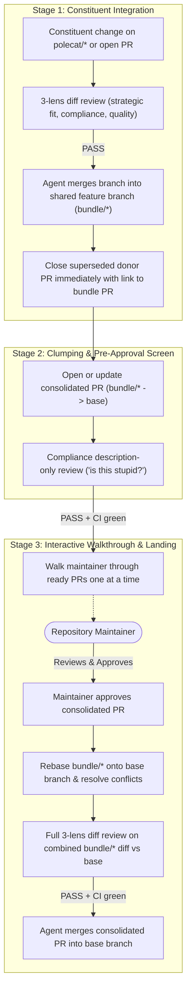

# Pull Request Lifecycle and Consolidated Feature-Branch Workflow

Deliver related changes to the repository maintainer as a single consolidated pull request on a shared feature branch rather than isolated per-task pull requests, while guaranteeing that every constituent change is reviewed on its diff before entering the feature branch, every consolidated pull request description is checked for proportionality and compliance before requesting maintainer approval, ready pull requests are walked through with the maintainer one at a time, and the combined diff against the base branch is reviewed in full after maintainer approval and rebase before merging.

## User experience flow

## Capabilities and user stories

### US-1: Consolidated feature-branch pull requests and constituent branch integration

**As a** repository maintainer reviewing incoming changes, **I want** related changes to be reviewed on their constituent branches and merged into a shared feature branch that closes any superseded donor pull requests immediately, **so that** I review one cohesive pull request per feature or theme rather than dozens of separate pull requests or duplicate open pull requests.

- **AC-1.1** **Given** a self-contained implementation task executing on a constituent `polecat/<slug>` branch that belongs to an epic, touches surfaces shared with other active work, or is part of a pull request consolidation batch, **When** local tests pass and the three-lens dialectical review (strategic fit, rule compliance, and quality) returns `PASS` on the full diff of `polecat/<slug>`, **Then** the agent merges `polecat/<slug>` directly into the shared feature branch (`bundle/<slug>` or `feat/<slug>`) within the same workflow pass without pausing for maintainer approval.
- **AC-1.2** **Given** an existing open standalone pull request whose commits are merged or cherry-picked into a shared feature branch (`bundle/<slug>`), **When** the consolidated pull request from `bundle/<slug>` is opened or updated on the remote repository, **Then** the agent closes the superseded donor pull request in the same step and posts a comment on the closed donor pull request linking to the consolidated pull request, leaving zero duplicate open pull requests for the same change.
- **AC-1.3** **Given** a batch of pre-existing unreviewed standalone pull requests being evaluated for consolidation into `bundle/<slug>`, **When** a candidate donor pull request is screened by the rule-compliance review lens on its title and description and returns `FAIL`, **Then** the agent excludes that donor pull request from `bundle/<slug>` and closes it with the compliance findings rather than merging defective work into the feature branch.
- **AC-1.4** **Given** a Stage 1 design or specification task whose output is a specification draft and design record, **When** the Stage 1 task completes its three-lens review, **Then** the design and specification draft are stored in the knowledge base with zero git branches and zero pull requests opened, and the Stage 2 build task commits the specification alongside the implementation on its constituent branch.

### US-2: Pre-approval description-only compliance review on consolidated pull requests

**As a** repository maintainer triaging pull requests ready for my sign-off, **I want** the pre-approval check on a consolidated feature-branch pull request to evaluate the pull request title and description for proportionality, architectural soundness, and data-boundary compliance without re-reviewing every line of constituent code on each merge, **so that** bad approaches are caught early and review spend scales with new information rather than repeating constituent diff reviews.

- **AC-2.1** **Given** a consolidated pull request from `bundle/<slug>` into the base branch where every constituent branch merged into `bundle/<slug>` has already recorded a three-lens diff `PASS`, **When** the consolidated pull request is opened or updated before maintainer approval, **Then** only the rule-compliance review lens runs a description-only review evaluating the consolidated pull request title, summary, approach, trade-offs, constituent review receipt table, donor closure status, and external-audience data boundaries, and posts `## RBG Review: PASS | REVISE | FAIL` on the pull request thread without re-running a three-lens line-by-line diff review across `bundle/<slug>`.
- **AC-2.2** **Given** a consolidated pull request on `bundle/<slug>` with green continuous integration checks on the branch head and `## RBG Review: PASS` posted on the pull request thread, **When** the branch is not yet up to date with the base branch, **Then** the agent marks the pull request ready for maintainer review without rebasing onto the base branch before maintainer approval.
- **AC-2.3** **Given** an isolated single-task change on `polecat/<slug>` that has zero thematic or file overlap with any active feature branch or open pull request (or is an explicitly authorized hotfix), **When** the change opens as a standalone pull request directly into the base branch, **Then** the three-lens diff review runs on that pull request's diff and posts its verdict to the pull request thread before the pull request is marked ready for maintainer approval.

### US-3: Open-PR consolidation sweep and one-at-a-time maintainer walkthrough

**As a** repository maintainer working through open pull requests across my projects, **I want** agents to first review and fix open pull requests, retarget and clump them into consolidated feature branches and hotfixes, and then bring ready pull requests to me one at a time with a structured run-down while adapting presentation to the active surface, **so that** I can evaluate and approve one cohesive unit at a time without cognitive overload.

- **AC-3.1** **Given** open pull requests across one or more repositories, **When** the consolidation workflow runs, **Then** it first dispatches agents in parallel to screen descriptions for compliance, run three-lens diff reviews on unreviewed pull requests, fix review findings and failing checks, and merge any pull requests that repository policy authorizes agents to merge autonomously.
- **AC-3.2** **Given** surviving reviewed pull requests that require maintainer approval, **When** the clumping stage runs, **Then** it retargets any stray base branches to the repository's integration branch, groups related pull requests into consolidated feature-branch pull requests (`bundle/<slug>`) while keeping zero-overlap urgent fixes as standalone hotfixes, closes every absorbed donor pull request in the same step with a link to its consolidated pull request, and runs the description-only compliance check on each consolidated pull request.
- **AC-3.3** **Given** one or more consolidated feature-branch pull requests or standalone hotfixes that are green and ready for maintainer review, **When** the interactive agent presents work to the maintainer, **Then** it brings **one pull request at a time** with a run-down of (1) what it does, (2) how it does it, and (3) what to pay attention to, leaving the exact presentation mechanics open to the interactive agent and its runtime surface and refining the workflow template from the maintainer's feedback after each pull request.

### US-4: Post-approval rebase, full combined diff review, and merge into the base branch

**As a** repository maintainer who has approved a consolidated pull request, **I want** the agent to rebase the feature branch onto the base branch, run the full three-lens review across the combined diff, and merge automatically once checks pass, **so that** cross-branch interactions and rebase conflict resolutions are verified before landing on the base branch without requiring a second manual merge step from me.

- **AC-4.1** **Given** a consolidated pull request from `bundle/<slug>` into the base branch that the maintainer has approved (or explicitly directed to land), **When** the post-approval landing workflow runs, **Then** the agent updates `bundle/<slug>` with the latest base branch head, resolves any merge conflicts, and runs the full three-lens dialectical review (strategic fit, rule compliance, and quality) across the complete combined diff of `bundle/<slug>` against the base branch.
- **AC-4.2** **Given** a post-approval consolidated pull request where the rebase onto the base branch is clean, the post-approval full three-lens diff review posts `PASS` (including `## RBG Review: PASS`) on the pull request thread, all continuous integration checks pass on the rebased head commit, and zero reviewers hold an active `CHANGES_REQUESTED` review, **When** the landing gate completes, **Then** the agent merges the consolidated pull request into the base branch and deletes the merged feature branch.
- **AC-4.3** **Given** a post-approval consolidated pull request where the post-approval full three-lens diff review returns `FAIL` or returns a `REVISE` finding that alters maintainer-approved behavior or scope, **When** the review verdict is posted to the pull request thread, **Then** the agent halts without merging and leaves the pull request open with the blocking findings for maintainer decision.

### US-5: Risk-tier merge authority across solo and gated repositories

**As a** developer working across both gated shared repositories and solo private repositories, **I want** the consolidated feature-branch workflow to adapt its final merge gate to the repository's risk and approval policy while keeping constituent branch integration and review gates consistent, **so that** one workflow template serves both maintainer-gated branches and autonomous solo repositories.

- **AC-5.1** **Given** a repository or target branch governed by a maintainer-approval rule (including `academicOps` `dev` and any public or collaborative repository), **When** a consolidated pull request reaches pre-approval readiness, **Then** no agent merges the consolidated pull request into the base branch until the maintainer approves it and the post-approval rebase and full three-lens diff review return `PASS`.
- **AC-5.2** **Given** a solo private repository where low-risk autonomous merge is authorized and a pull request contains only low-risk changes (no secrets, authentication, destructive data migrations, CI/CD permissions, or public API breaks), **When** continuous integration checks pass and the three-lens diff review against the base branch returns `PASS`, **Then** the agent merges the pull request into the base branch without pausing for manual approval.

## Shared interface contract

Every consolidated pull request and review comment published to the repository hosting platform adheres to the following structure:

1. **Consolidated Pull Request Description Contract** (per `.github/PULL_REQUEST_TEMPLATE.md`):
   - `## Summary`: Cohesive statement of what the consolidated branch achieves and why.
   - `## Approach`: Modular architectural explanation of how the constituent changes fit together.
   - `## Trade-offs`: Explicit design trade-offs and rejected alternatives.
   - `## Constituent Changes & Review Receipts`: Markdown table listing each merged `polecat/<slug>` branch (and any closed superseded donor pull request `#<number>`), its scope, and its three-lens diff verdict (`PASS`).
   - `## Test Receipt`: Concrete verification commands and pass receipts.
2. **Review Comment Signatures on the Pull Request Thread**:
   - Pre-approval compliance description check: top-level comment containing `## RBG Review: PASS | REVISE | FAIL` and noting scope `Description-only pre-approval check (constituent diffs verified on polecat/* branches)`.
   - Post-approval combined diff review: top-level comment containing `## Strategic Review: PASS | REVISE | FAIL` and `## RBG Review: PASS | REVISE | FAIL` covering the full combined diff against the base branch.

## Invariants and security boundaries

- **Zero Unreviewed Code in Feature or Base Branches**: No `polecat/*` branch is merged into `bundle/<slug>` without a three-lens diff `PASS`, and no `bundle/<slug>` branch is merged into the base branch without a post-approval full three-lens diff `PASS` on the combined diff against the base branch.
- **No Duplicate Open Pull Requests**: A change exists in at most one open pull request at any time; absorbing a standalone pull request into a consolidated pull request closes the donor pull request immediately in the same step.
- **Single-Decision Serialization in Walkthroughs**: Ready consolidated pull requests and standalone hotfixes are presented to the maintainer strictly one at a time, never as a multi-PR approval dump.
- **Block on `CHANGES_REQUESTED`**: No pull request is ever merged while any reviewer on the hosting platform holds an active `CHANGES_REQUESTED` review state, regardless of other approvals.
- **Release Automation Exemption**: Automated release pull requests (such as `release-please` pull requests from `dev` to `main`) are excluded from agent consolidation, rebase, and merge workflows.
- **External-Audience Data Boundary (`data-boundaries`)**: Pull request titles, descriptions, commit messages, branch names, and review comments on public or external-audience repositories must contain zero internal knowledge-base identifiers, task identifiers, session identifiers, private hostnames, or deployment-only persona names.
